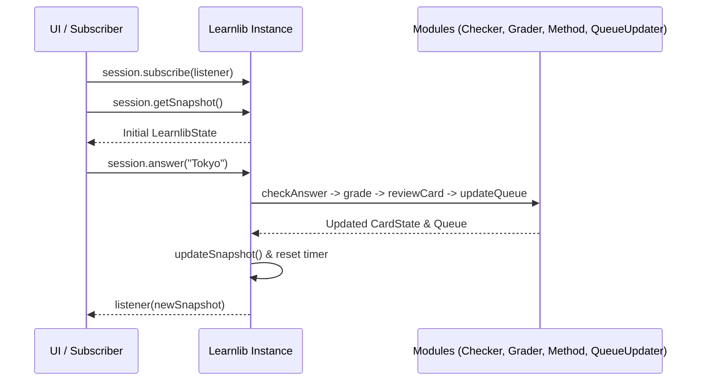

# Learnlib Class

`Learnlib` (exported as both a named export and the `default` export of `@siemsiem/learnlib`) is the main session controller that manages card state, active review queues, response timing, module configurations, and state subscriptions.


Looking for practical patterns and UI framework examples? See [Using the Learnlib Class](../getting-started/using-learnlib.md).


## Import

```typescript
import Learnlib, { type LearnlibOptions, type LearnlibState } from "@siemsiem/learnlib";
```

---

## Constructor

`Learnlib` supports both an options-object overload and a positional overload:

```typescript
new Learnlib(options: LearnlibOptions)
new Learnlib(
  optionsOrCards: LearnlibOptions | CardState[] | LearnlibState,
  method?: LearningMethod | string,
  grader?: GradeMaker | string,
  queueUpdater?: QueueUpdater | string,
  checkConfig?: CheckConfig,
  initialConfigs?: Record<string, any> | string
)
```

### `LearnlibOptions`

| Property | Type | Default | Description |
|---|---|---|---|
| `cards` | `CardState[] \| LearnlibState` | *Required* | Array of cards (partial or full) or a previously saved `LearnlibState` object |
| `method` | `LearningMethod \| string` | `"simple"` | Active learning method instance or registered module ID in `globalModuleTracker` |
| `grader` | `GradeMaker \| string` | `"basic"` | Active grade maker instance or registered module ID in `globalModuleTracker` |
| `queueUpdater` | `QueueUpdater \| string` | `"simple"` | Active queue updater instance or registered module ID in `globalModuleTracker` |
| `checkConfig` | `CheckConfig` | `{}` | Session-level answer checker configuration overrides |
| `configs` | `Record<string, any>` | `undefined` | Initial module configs applied via `importConfigJson()` on construction |

### Initialization Behavior

1. **Module Resolution:** String module identifiers (`method`, `grader`, `queueUpdater`) are resolved via `globalModuleTracker.getOrThrow(id, type)`. Passing an unknown ID or a module of the wrong type throws an `Error`.
2. **Initial Configurations:** If `configs` / `initialConfigs` is provided (either as an object or JSON string), `this.importConfigJson()` is called before processing cards.
3. **Card Normalization & Queue Setup:**
   - **When given a `CardState[]` array:** Every card is normalized via `upgradeTools.upgradeCard(k)`, `history` is initialized to `[]`, `queue` is shuffled with Fisher–Yates shuffle, `current` is set to `queue[0] ?? null`, and `initialCount` is set to `queue.length`.
   - **When given a `LearnlibState` object:** Preserves `history`, `initialCount`, and the existing `queue` order without reshuffling (unless `current` is `undefined`).
4. **`methodId` Validation:**
   - If `this.current` has an empty `methodId`, `Learnlib` automatically assigns `this.method.id` to all cards in `queue` and `cards`.
   - If `this.current.methodId` is non-empty and does not match `this.method.id`, the constructor throws:
     `Error: Card methodId '<card.methodId>' does not match active method '<this.method.id>'`.
5. **Timer & Snapshot:** Starts the internal response timer (`cStart = new Date()`) and caches the initial `LearnlibState` snapshot.

---

## Instance Properties

| Property | Type | Dutch Alias | Description |
|---|---|---|---|
| `cards` | `CardState[]` | `lijst` | All cards in the deck, updated in place as reviews occur |
| `queue` | `CardState[]` | `wachtrij` | Remaining cards in the active review queue |
| `current` | `CardState \| null` | — | Card currently at the front of the queue (`queue[0] ?? null`), or `null` when empty |
| `history` | `CardSnapshot[]` | — | Chronological log of all `CardSnapshot` entries recorded during this session |
| `initialCount` | `number` | — | Initial queue length used as the denominator for `queueState.progress` |
| `method` | `LearningMethod` | `methode` | Active learning method module |
| `grader` | `GradeMaker` | — | Active grade maker module |
| `queueUpdater` | `QueueUpdater` | `wachtrijUpdater` | Active queue updater module |
| `checkConfig` | `CheckConfig` | — | Session-level answer checker configuration |

---

## Session & Queue Methods

### `answer(uAnswer, gradeOverwrite?, checkConfigOverride?)`

Processes a user's answer for `this.current`. If `this.current` is `null` (the queue is already empty), `answer()` returns immediately as a no-op.

```typescript
public answer(
  uAnswer: string,
  gradeOverwrite?: Grade,
  checkConfigOverride?: CheckConfig
): void
```

- **Parameters:**
  - `uAnswer` (`string`): The user's submitted answer string.
  - `gradeOverwrite` (`Grade`, optional): If provided, bypasses `this.grader.grade()` and uses this `Grade` directly (`Grade.Incorrect`, `Grade.Hard`, `Grade.Good`, or `Grade.Easy`).
  - `checkConfigOverride` (`CheckConfig`, optional): If provided, overrides `this.checkConfig` for this single check call.
- **Execution Order:**
  1. Captures `endTime = new Date()`.
  2. Calls `checkAnswer(this.current.answer, uAnswer, checkConfigOverride ?? this.checkConfig)`.
  3. Computes `grade = gradeOverwrite ?? this.grader.grade(isCorrect, this.cStart, endTime)`.
  4. Appends a `{ date: endTime, cardId, answer: uAnswer, grade }` snapshot to both `this.history` and `this.current.history`.
  5. Calls `this.method.reviewCard(this.current, grade, endTime, snapshot)` and updates the card in `this.queue[0]` and `this.cards`.
  6. Calls `this.queueUpdater.updateQueue(snapshot, this.current, grade)` and sets `this.queue = newState.queue` and `this.current = this.queue[0] ?? null`.
  7. Resets the internal response timer (`this.cStart = new Date()`) for the next card and notifies all subscribed listeners.
- **Dutch alias:** `antwoord(uAnswer, gradeOverwrite?, checkConfigOverride?)`

---

### `reshuffle()`

Randomly shuffles the remaining cards in `this.queue` using the Fisher–Yates algorithm, updates `this.current` to `this.queue[0] ?? null`, resets the response timer (`cStart`), and notifies all subscribers.

```typescript
public reshuffle(): void
```

---

### `reset()`

Restores `this.queue` to a shallow copy of all cards in `this.cards` (`[...this.cards]`) and immediately calls `this.reshuffle()`.

```typescript
public reset(): void
```

---

## Reactive State Methods

### `subscribe(listener)`

Registers a callback that fires whenever the session state changes (`answer()`, `reshuffle()`, or `reset()`). Returns an `unsubscribe` function.

```typescript
public subscribe: (listener: (state: LearnlibState) => void) => () => void
```

### `getSnapshot()`

Returns the latest cached `LearnlibState` object. The returned reference stays stable between state changes, satisfying React's `useSyncExternalStore` requirements.

```typescript
public getSnapshot: () => LearnlibState
```



---

## Configuration Methods

### `setConfig(moduleId, config, type?)`

Deep-merges `config` into both the active session module (if `this.method`, `this.grader`, or `this.queueUpdater` matches `moduleId` and `type`) and `globalModuleTracker`. Returns `this` for chaining.

```typescript
public setConfig(moduleId: string, config: any, type?: ModuleType): this
```

### `getConfig(moduleId, type?)`

Returns the current `config` object for `moduleId` from the active session module (if matched) or `globalModuleTracker`.

```typescript
public getConfig(moduleId: string, type?: ModuleType): any
```

### `exportConfigJson(pretty?)` / `getConfigJson(pretty?)`

Serializes all non-empty module configurations in `globalModuleTracker` to a JSON string. Pass `pretty = true` for 2-space indentation.

```typescript
public exportConfigJson(pretty?: boolean): string
```

### `importConfigJson(json)`

Parses a JSON string (or takes a `Record<string, any>` object) and applies each `[moduleId, config]` entry via `this.setConfig(id, cfg)`. Returns `this`.

```typescript
public importConfigJson(json: string | Record<string, any>): this
```
