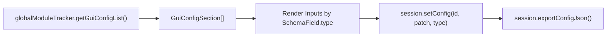

# Making a Module Settings GUI

LearnLib's module and schema system is designed so you never have to hardcode settings forms for individual modules. Every module registered in `globalModuleTracker` — whether built-in or third-party — exposes its metadata, typed `schema`, and current `config` via `getGuiConfigList()`.



---

## What `getGuiConfigList()` Returns

Calling `globalModuleTracker.getGuiConfigList()` returns an array of `GuiConfigSection` objects:

```typescript
export interface GuiConfigSection {
  id: string;
  type?: "method" | "queueUpdater" | "gradeMaker" | "checker" | "preprocessor";
  name: string | multiLangString;
  description: string | multiLangString;
  aboutLink?: string;
  schema: Record<string, SchemaField>;
  config: Record<string, any>;
}
```


Modules without configurable options (such as `SimpleMethod` or `VerySimpleGradeMaker`) still appear in `getGuiConfigList()` with `schema: {}` so you can list them in a module selector dropdown, while filtering `Object.keys(section.schema).length > 0` when rendering parameter forms.


---

## Step-by-Step Implementation Guide



## Resolve localized labels (`multiLangString`)

Module names, descriptions, and schema field labels can be plain strings or `{ EN?: string; NL?: string }` objects. Create a small helper to pick the active language with a fallback:

```typescript
import type { multiLangString } from "@siemsiem/learnlib";

export type Locale = "EN" | "NL";

export function t(value: string | multiLangString | undefined, locale: Locale = "EN"): string {
  if (!value) return "";
  if (typeof value === "string") return value;
  return value[locale] ?? value.EN ?? value.NL ?? "";
}
```



## Group or filter `getGuiConfigList()`

Fetch all registered modules from `globalModuleTracker`. You can group them by `type` or filter to only modules that declare schema fields:

```typescript
import { globalModuleTracker, type GuiConfigSection } from "@siemsiem/learnlib";

// All modules that have at least one configurable setting
const configurableSections: GuiConfigSection[] = globalModuleTracker
  .getGuiConfigList()
  .filter((section) => Object.keys(section.schema).length > 0);
```



## Map each `SchemaField` to a form control

Each entry in `section.schema` is a discriminated union on `field.type`. Map each `type` to the corresponding HTML input element:

| `field.type` | Schema Properties | Recommended UI Control | Value Type |
|---|---|---|---|
| `"boolean"` | `default: boolean` | Checkbox or Toggle switch (`<input type="checkbox">`) | `boolean` |
| `"number"` | `default: number`, `min?`, `max?`, `step?` | Range slider + number input (`<input type="number">`) | `number` |
| `"string"` | `default: string`, `maxLength?`, `pattern?` | Text input (`<input type="text">`) | `string` |
| `"select"` | `options: readonly string[]`, `default: string` | Dropdown select (`<select>`) | `string` |
| `"array"` | `items: "string" \| "number" \| "boolean"`, `default?` | Comma-separated input or tag chip editor | `Array<string \| number \| boolean>` |



## Apply updates & persist to storage

Whenever the user changes a field in your GUI, call `session.setConfig()` (or `globalModuleTracker.setConfig()` if no session is active yet) and save `exportConfigJson()`:

```typescript
function handleFieldChange(
  section: GuiConfigSection,
  fieldKey: string,
  newValue: unknown
) {
  session.setConfig(section.id, { [fieldKey]: newValue }, section.type);
  localStorage.setItem("learnlib_configs", session.exportConfigJson());
}
```



---

## Complete Framework Examples

Below are complete, self-contained components that render a full settings GUI for every configurable module in LearnLib, including a **Reset to Defaults** button per module.




```tsx
import React, { useState } from "react";
import {
  globalModuleTracker,
  extractDefaults,
  type Learnlib,
  type GuiConfigSection,
  type SchemaField,
  type multiLangString,
} from "@siemsiem/learnlib";

type Locale = "EN" | "NL";

function t(val: string | multiLangString | undefined, locale: Locale): string {
  if (!val) return "";
  if (typeof val === "string") return val;
  return val[locale] ?? val.EN ?? val.NL ?? "";
}

export function ModuleSettingsGui({
  session,
  locale = "EN",
}: {
  session?: Learnlib;
  locale?: Locale;
}) {
  const [sections, setSections] = useState<GuiConfigSection[]>(() =>
    globalModuleTracker.getGuiConfigList()
  );

  const refresh = () => setSections(globalModuleTracker.getGuiConfigList());

  const updateField = (section: GuiConfigSection, key: string, value: any) => {
    if (session) {
      session.setConfig(section.id, { [key]: value }, section.type);
    } else {
      globalModuleTracker.setConfig(section.id, { [key]: value }, section.type);
    }
    localStorage.setItem(
      "learnlib_configs",
      globalModuleTracker.exportConfigJson()
    );
    refresh();
  };

  const resetSection = (section: GuiConfigSection) => {
    const defaults = extractDefaults(section.schema);
    if (session) {
      session.setConfig(section.id, defaults, section.type);
    } else {
      globalModuleTracker.setConfig(section.id, defaults, section.type);
    }
    refresh();
  };

  const configurable = sections.filter(
    (s) => Object.keys(s.schema).length > 0
  );

  return (
    <div className="learnlib-settings">
      {configurable.map((section) => (
        <fieldset key={`${section.type}:${section.id}`}>
          <legend>
            <strong>{t(section.name, locale)}</strong>{" "}
            <small>({section.type})</small>
          </legend>
          <p>{t(section.description, locale)}</p>

          {Object.entries(section.schema).map(([key, field]) => {
            const typedField = field as SchemaField;
            const currentValue =
              section.config[key] ?? (typedField as any).default;

            return (
              <div key={key} style={{ marginBottom: "0.75rem" }}>
                <label>
                  <strong>{t(typedField.label, locale) || key}</strong>
                  {typedField.description && (
                    <small style={{ display: "block" }}>
                      {t(typedField.description, locale)}
                    </small>
                  )}

                  {typedField.type === "boolean" && (
                    <input
                      type="checkbox"
                      checked={Boolean(currentValue)}
                      onChange={(e) =>
                        updateField(section, key, e.target.checked)
                      }
                    />
                  )}

                  {typedField.type === "number" && (
                    <input
                      type="number"
                      value={Number(currentValue)}
                      min={typedField.min}
                      max={typedField.max}
                      step={typedField.step}
                      onChange={(e) =>
                        updateField(section, key, Number(e.target.value))
                      }
                    />
                  )}

                  {typedField.type === "string" && (
                    <input
                      type="text"
                      value={String(currentValue ?? "")}
                      maxLength={typedField.maxLength}
                      pattern={typedField.pattern}
                      onChange={(e) =>
                        updateField(section, key, e.target.value)
                      }
                    />
                  )}

                  {typedField.type === "select" && (
                    <select
                      value={String(currentValue)}
                      onChange={(e) =>
                        updateField(section, key, e.target.value)
                      }
                    >
                      {typedField.options.map((opt) => (
                        <option key={opt} value={opt}>
                          {opt}
                        </option>
                      ))}
                    </select>
                  )}

                  {typedField.type === "array" && (
                    <input
                      type="text"
                      value={
                        Array.isArray(currentValue)
                          ? currentValue.join(", ")
                          : ""
                      }
                      onChange={(e) => {
                        const rawItems = e.target.value
                          .split(",")
                          .map((s) => s.trim())
                          .filter(Boolean);
                        const parsed =
                          typedField.items === "number"
                            ? rawItems.map(Number)
                            : typedField.items === "boolean"
                            ? rawItems.map((v) => v === "true")
                            : rawItems;
                        updateField(section, key, parsed);
                      }}
                    />
                  )}
                </label>
              </div>
            );
          })}

          <button type="button" onClick={() => resetSection(section)}>
            Reset to Defaults
          </button>
        </fieldset>
      ))}
    </div>
  );
}
```





```typescript
import {
  globalModuleTracker,
  type Learnlib,
  type GuiConfigSection,
  type SchemaField,
} from "@siemsiem/learnlib";

export function renderSettingsGui(
  container: HTMLElement,
  session?: Learnlib,
  locale: "EN" | "NL" = "EN"
) {
  const t = (val: any): string =>
    typeof val === "string" ? val : val?.[locale] ?? val?.EN ?? "";

  const sections = globalModuleTracker
    .getGuiConfigList()
    .filter((s) => Object.keys(s.schema).length > 0);

  container.innerHTML = "";

  for (const section of sections) {
    const fieldset = document.createElement("fieldset");
    const legend = document.createElement("legend");
    legend.textContent = `${t(section.name)} (${section.type})`;
    fieldset.appendChild(legend);

    for (const [key, rawField] of Object.entries(section.schema)) {
      const field = rawField as SchemaField;
      const wrapper = document.createElement("div");
      const label = document.createElement("label");
      label.textContent = `${t(field.label) || key}: `;

      const currentValue = section.config[key] ?? (field as any).default;

      const applyValue = (val: any) => {
        if (session) {
          session.setConfig(section.id, { [key]: val }, section.type);
        } else {
          globalModuleTracker.setConfig(section.id, { [key]: val }, section.type);
        }
      };

      if (field.type === "boolean") {
        const input = document.createElement("input");
        input.type = "checkbox";
        input.checked = Boolean(currentValue);
        input.addEventListener("change", () => applyValue(input.checked));
        label.appendChild(input);
      } else if (field.type === "number") {
        const input = document.createElement("input");
        input.type = "number";
        input.value = String(currentValue);
        if (field.min !== undefined) input.min = String(field.min);
        if (field.max !== undefined) input.max = String(field.max);
        if (field.step !== undefined) input.step = String(field.step);
        input.addEventListener("change", () => applyValue(Number(input.value)));
        label.appendChild(input);
      } else if (field.type === "select") {
        const select = document.createElement("select");
        for (const opt of field.options) {
          const option = document.createElement("option");
          option.value = opt;
          option.textContent = opt;
          option.selected = opt === currentValue;
          select.appendChild(option);
        }
        select.addEventListener("change", () => applyValue(select.value));
        label.appendChild(select);
      } else if (field.type === "array") {
        const input = document.createElement("input");
        input.type = "text";
        input.value = Array.isArray(currentValue) ? currentValue.join(", ") : "";
        input.addEventListener("change", () => {
          const items = input.value
            .split(",")
            .map((s) => s.trim())
            .filter(Boolean);
          applyValue(items);
        });
        label.appendChild(input);
      } else {
        const input = document.createElement("input");
        input.type = "text";
        input.value = String(currentValue ?? "");
        input.addEventListener("change", () => applyValue(input.value));
        label.appendChild(input);
      }

      wrapper.appendChild(label);
      fieldset.appendChild(wrapper);
    }

    container.appendChild(fieldset);
  }
}
```




---

## Building a Module Selector Dropdown

In addition to editing each module's `config`, you can populate dropdowns that let the user choose which **LearningMethod**, **GradeMaker**, or **QueueUpdater** to use when starting a session:

```typescript
import { globalModuleTracker } from "@siemsiem/learnlib";

const availableMethods = globalModuleTracker.getMethods();
// -> [{ id: "simple", name: { EN: "Simple", NL: "Eenvoudig" }, ... }, { id: "fsrs", ... }]

const availableGraders = globalModuleTracker.getGradeMakers();
// -> [{ id: "basic", name: { EN: "Very Simple Grader", ... }, ... }]

const availableQueues = globalModuleTracker.getQueueUpdaters();
// -> [{ id: "simple", name: { EN: "Simple Queue", ... }, ... }]
```


Because `globalModuleTracker` is also attached to `window.LEARNLIB_MODULE_API` in browser builds, external browser extensions or user scripts can register custom modules at runtime and they will automatically appear in your settings GUI the next time `getGuiConfigList()` is called.

