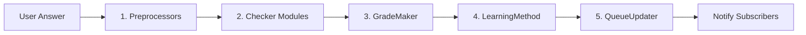

# Core Concepts

LearnLib separates flashcard state management from the algorithms that check answers, grade performance, schedule intervals, and reorder the queue.

## Review Pipeline

Whenever you call `session.answer(userAnswer)`, LearnLib executes a five-stage pipeline:



1. **Preprocessors** normalize both the expected answer and user input (e.g., lowercasing, stripping accents, converting Greek characters, or removing leading articles).
2. **Checker Modules** expand syntax rules in the expected answer — such as optional parts `(like this)`, unordered lists `[a, b, c]`, and `/` alternatives — to determine whether the user's answer is correct.
3. **GradeMaker** converts the boolean correctness result and response time (`start` to `endTime`) into a `Grade` (`Incorrect`, `Hard`, `Good`, or `Easy`), unless a manual `gradeOverwrite` was provided.
4. **LearningMethod** updates the card's scheduling fields (`lastReviewed`, `nextReview`, and `metadata` such as stability/difficulty or `learned`).
5. **QueueUpdater** produces the next queue state (for example, removing mastered cards or reinserting failed cards at a random position) and notifies all subscribers.

## The Five Module Types

Every pluggable behavior in LearnLib implements the `BaseModule` interface and belongs to one of five module types:

| Module Type | Interface | Responsibility | Built-in Implementations |
|---|---|---|---|
| `"method"` | `LearningMethod` | Schedules `nextReview` and updates card metadata after each review | `SimpleMethod` (`"simple"`), `FsrsMethod` (`"fsrs"`) |
| `"checker"` | `CheckModule` | Expands answer syntax rules into valid answer variants | `OptionalAnswerPartsModule`, `UnorderedAnswerPartsModule`, `AlternativeAnswersModule` |
| `"preprocessor"` | `Preprocessor` | Normalizes answer strings once before variant checking | `CaseInsensitivePreprocessor`, `StripAccentsPreprocessor`, `GreekPreprocessor`, `RemoveArticlesPreprocessor` |
| `"gradeMaker"` | `GradeMaker` | Translates `correct` boolean and timing into a `Grade` enum | `VerySimpleGradeMaker` (`"basic"`) |
| `"queueUpdater"` | `QueueUpdater` | Mutates or filters the active card queue after grading | `SimpleQueueUpdater` (`"simple"`) |

## Card State & Snapshots

Each flashcard is represented by a `CardState` object:

```typescript
interface CardState {
  id: string;
  question: string;
  answer: string;
  phase: Phase;               // Phase.Learning (0) | Phase.Review (1)
  methodId: string;           // ID of the active LearningMethod (e.g., "simple" or "fsrs")
  lastReviewed: Date;
  nextReview: Date;
  history: CardSnapshot[];    // Review log entries for this card
  metadata: Record<string, any>;
}
```


A card's `methodId` must match the `Learnlib` session's active `method.id`. If you load cards that have an empty `methodId`, `Learnlib` automatically assigns the active method's ID. If a card already has a *different* `methodId`, the constructor throws an error to prevent mixing incompatible scheduling metadata.

